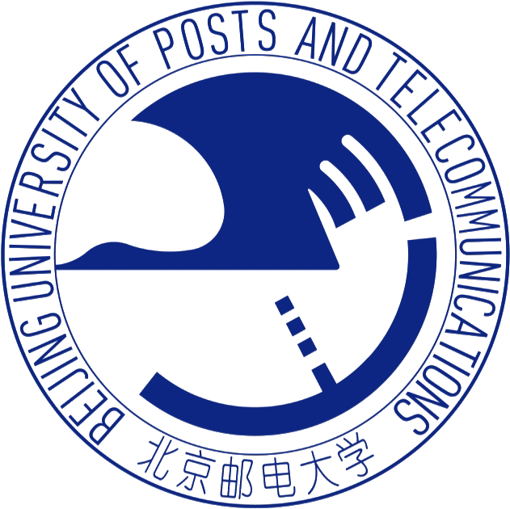

<h3 align="center">
  <samp>Hi, I'm Xingchen Li. AI &amp; Software Developer.</samp>
</h3>

  👋 Currently focused on <strong>AI agents, LLM safety, and edge AI</strong>.

  <code>🏡 From Jiangsu, China</code>
  <code>📍 Based in Beijing</code>

  M.Sc. student in Software Engineering at 
  &nbsp; <strong>Beijing University of Posts and Telecommunications</strong> 
  Sep 2024 – Jun 2027 (expected)

<table>
  <tr>
    <td width="50%" valign="top">
      <h3>🌱 Internship Experience</h3>
      

        <picture><source media="(prefers-color-scheme: dark)" srcset="assets/china-telecom-white.svg"></picture>&nbsp; <strong>China Telecom · Beijing Branch</strong> 
        LLM Algorithm Intern 
        <code>Jul 2026 – Sep 2026</code> 
        Agent data pipelines, AI compute recommendation, and inference benchmarking.
      

      

        <picture><source media="(prefers-color-scheme: dark)" srcset="assets/audi-rings-white.svg"></picture>&nbsp; <strong>Audi China</strong> 
        AI &amp; Software Development Intern · C/EV-L 
        <code>Apr 2026 – Jul 2026</code> 
        Multi-agent vehicle diagnostics, hybrid RAG, and procurement workflow automation.
      

      

        &nbsp; <strong>China Mobile · Jiutian AI Research Institute</strong> 
        LLM Safety &amp; Trustworthiness Intern 
        <code>Jan 2026 – Apr 2026</code> 
        Agentic RL, risk-aware sampling, and GRPO-based safety alignment.
      

    </td>
    <td width="50%" valign="top">
      <h3>💻 Open Source Projects</h3>
      
<picture><source media="(prefers-color-scheme: dark)" srcset="assets/china-telecom-white.svg"></picture>&nbsp; <strong>China Telecom internship</strong>

      <ul>
        <li>
          <a href="https://gitee.com/aishperf-caict/aishperf_openness"><strong>AISHPerf</strong></a> 
          AI chip and model benchmarking for training and inference.
        </li>
        <li>
          <a href="https://github.com/bupt-lxc/chip-recommend"><strong>chip-recommend</strong></a> 
          Agent-driven data collection and AI compute recommendation, with CLI and API access.
        </li>
      </ul>
      
<picture><source media="(prefers-color-scheme: dark)" srcset="assets/audi-rings-white.svg"></picture>&nbsp; <strong>Audi internship</strong>

      <ul>
        <li>
          <a href="https://github.com/bupt-lxc/AIVehicleDiagnose"><strong>AIVehicleDiagnose</strong></a> 
          Multi-agent vehicle diagnostics with RAG and root-cause analysis.
        </li>
        <li>
          <a href="https://github.com/bupt-lxc/contract"><strong>contract</strong></a> 
          Procurement, contract, and supplier management with Outlook notifications.
        </li>
      </ul>
    </td>
  </tr>
</table>

  Python · Java · C++ · PyTorch · LangGraph · FastAPI · vLLM 
  <a href="mailto:lxc983@bupt.edu.cn">lxc983@bupt.edu.cn</a>

